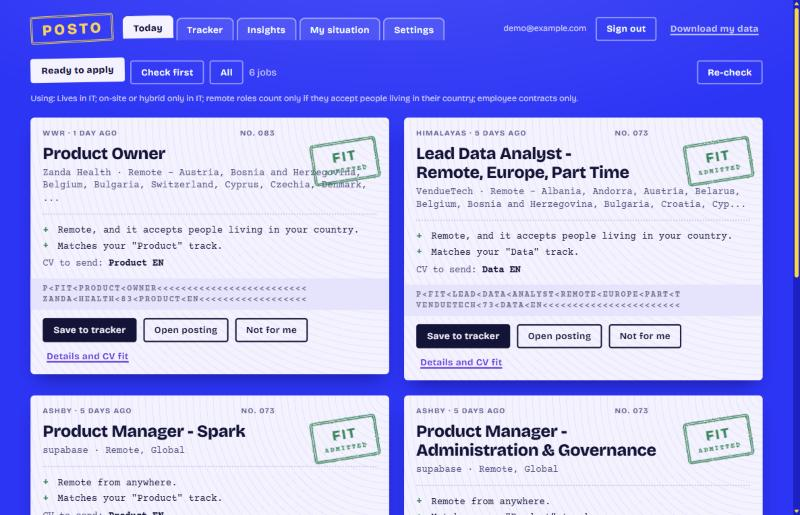
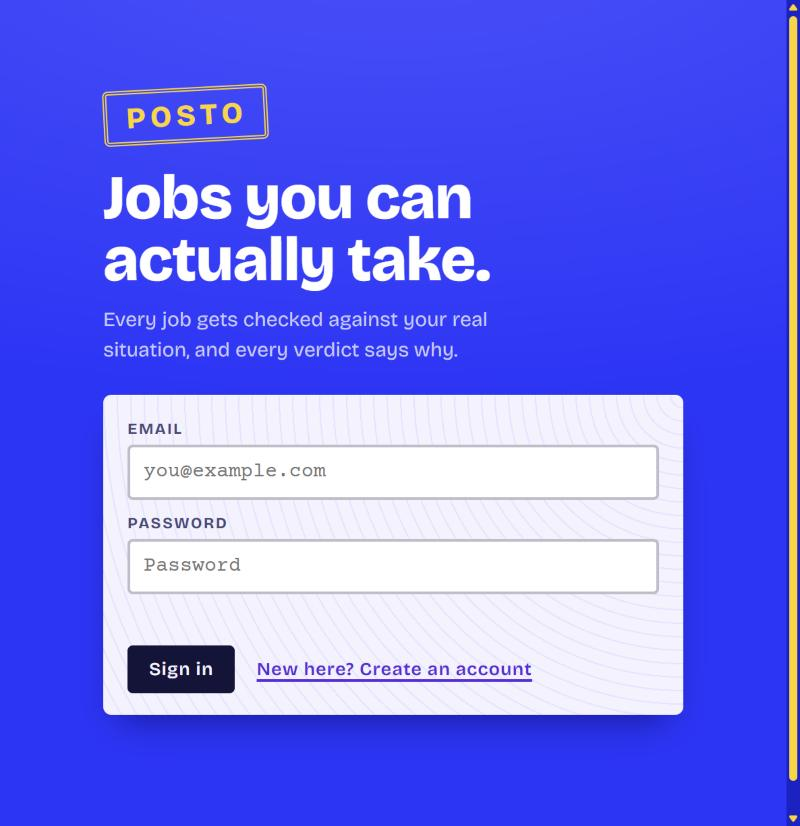

# Posto

<p align="center"></p>

*Posto* is Italian for a place, a seat, a job.



An open-source job search assistant that runs on your own computer. It finds jobs **you can actually apply to**,
given your real situation, then tracks your applications and reads your inbox for the replies.

Most job boards filter by keyword and location. They do not know that you only have a 20-hour work permit, that you
need visa sponsorship, that "remote" in this posting means "US residents only", or that you do not speak German.
You find out after reading the whole posting, or after applying. This project checks those things first and tells you
**why** a job is in or out, in plain words.

- **Local-first.** One Node process and one SQLite file on your machine. No account with anyone, no cloud, no tracking.
- **No runtime dependencies** for the core (Node's built-in SQLite, `fetch` and `crypto`). Email checking uses two optional packages.
- **Explainable.** Every blocked or flagged job carries a sentence saying what is wrong with it.
- **Built for different situations**: a student with an hours cap, someone relocating who needs sponsorship, a remote-only freelancer.



## Quick start

Needs [Node.js](https://nodejs.org) 22.13 or newer.

```bash
git clone https://github.com/ahmedmetered/posto.git && cd posto
npm install          # only needed for email checking (imapflow, mailparser); skip it if you do not want that
npm start            # http://localhost:7678
```

Open the address, create a local account, describe your situation, then use **Settings > Run the sweep now** to fetch
jobs. After that a sweep runs by itself every day at the hour you choose, as long as the app is running.

Environment variables: `PORT` (default 7678), `DB_FILE` (default `data/app.db`), `DATA_DIR` (where the encryption key
lives, default `data/`), `NO_SCHEDULER=1` (do not run the daily sweep from this process).

## What it does

| | |
|---|---|
| **Situation profile** | Country, where on-site work is fine, remote eligibility, relocation and visa sponsorship, weekly hour cap, contract types, self-employment, languages, seniority, minimum pay, role types with their keywords and CV |
| **Eligibility engine** | `evaluate(job, profile)` returns `fit`, `check` or `no`, a score and every reason. See [How a decision is made](#how-a-decision-is-made) |
| **Daily sweep** | Pulls public job feeds and company career pages, matches every posting against your profile, keeps what you have not already acted on |
| **Why nothing matched** | When the feed is empty it says what blocks the postings whose titles match your role types ("108 are remote for other countries, 92 are full-time over your hours limit...") |
| **Tracker** | Statuses, notes, which CV you sent, reply threads, top picks, "easy apply" marker |
| **Email reply tracking** | Reads your inbox over IMAP (read-only), finds replies from companies you applied to, updates the status and attaches the email to the card. Italian and English. Uncertain matches go to a review list instead of being applied |
| **CV builder** | Build a one-page, ATS-friendly CV from structured fields with a live preview and a fit check, and print it to PDF with the Chrome or Edge already on your machine. No LaTeX, no library. Start from a CV you saved or tailor one for a job through the AI agent you already use (copy a brief, paste back its JSON), then save it so it also counts when Posto compares your CVs with a job |
| **CVs** | Upload `.docx`, `.pdf`, `.txt` or paste text. For every job it shows which of your CVs covers the posting best and which key terms are missing |
| **AI tailoring (optional)** | Tailored summary, cover letter or gap list, grounded in your CV only. Anthropic, any OpenAI-compatible API, or a local model through Ollama so nothing leaves your machine. Or press "Brief" to copy the posting, your CV and the rules for the AI agent you already use (see `skills/tailor`) |
| **Daily digest** | In the app, and optionally pushed to your phone via ntfy.sh, a Discord or Slack webhook |
| **Browser extension** | For LinkedIn, Indeed or any page: a side panel that stays open while you browse; press Check this page on a posting to see whether it fits you and save it to the tracker. It reads a page only when you press the button |
| **Insights** | Response rate, typical days to a reply, which CV gets answers |

### Job sources

Only public, documented feeds and career pages are used. The app does not log in to, scrape or crawl LinkedIn or Indeed;
the browser extension covers those by reading the single page you are looking at, on your click.

| Source | Kind |
|---|---|
| Greenhouse, Ashby, Lever, Workable, Recruitee, SmartRecruiters | Company career pages (you choose the companies in Settings; 19 are preloaded) |
| Himalayas, Remotive, RemoteOK, We Work Remotely, Jobicy | Remote job feeds |
| Arbeitnow | Germany and Europe, including on-site |

RemoteOK and Jobicy ask for credit and a link back; the source name and posting link are shown on every card.

## How a decision is made

`src/eligibility.mjs` is a pure function with no network or database access, which makes it easy to test and to trust.
For one job and one profile it checks, in order: personal exclusions, unpaid roles, location and work mode (including
which countries a "remote" job accepts), relocation and visa sponsorship, hours and contract type (permit limits,
self-employment), languages, seniority, pay, and whether the title matches a role type you want.

Any blocking reason gives `no`. Anything that needs confirming (an unclear remote region, no word on sponsorship, a posting
that is probably full-time when you can work 20 hours) gives `check`. Otherwise `fit`.

```
Job:      "Product Manager", Remote (United States)
Profile:  lives in Italy
Result:   no     Remote, but limited to United States, not your country.

Job:      "Product Manager", Remote, full-time (not stated explicitly)
Profile:  lives in Italy, 20 hours a week
Result:   check  Probably full-time, and you can work 20 hours a week. Ask if part-time is possible.
```

`test/eligibility.test.mjs` documents the edge cases (for example "Anywhere in France" is not worldwide).

## Privacy and security

- Everything is stored in `data/app.db` on your machine. `GET /api/export` downloads all of it; deleting your account removes every row tied to it.
- Mailbox and AI-key secrets are encrypted with AES-256-GCM using a key in `data/secret.key`. That protects a copied database file, not someone who can read both files, so treat the `data/` folder like a password-manager vault.
- Mailboxes are opened read-only. Nothing is flagged, moved or deleted. Email text is only matched against fixed patterns, never executed or sent anywhere.
- The server listens on `127.0.0.1` only. Passwords use scrypt, sessions are random tokens stored hashed, cookies are `HttpOnly` and `SameSite=Lax`, state-changing requests from other origins are rejected, and all UI text goes through `textContent`.
- The browser extension uses a personal access token (stored hashed, revocable) that can only check and save jobs.
- Posting text and your CV go to an AI provider **only** if you configure one and press a tailoring button.

It is designed for one person or a household on their own computer, not for the open internet. If you expose it anyway, put it behind HTTPS and set `SECURE_COOKIES=1`.

## Project layout

| Path | Job |
|---|---|
| `src/eligibility.mjs`, `src/profile.mjs`, `src/geo.mjs` | Situation profile, location parsing, the decision |
| `src/sources/index.mjs`, `src/sweep.mjs`, `src/boards.json` | Source adapters (parse functions tested against fixtures), ingest, per-user matching |
| `src/mail/classify.mjs`, `src/mail/check.mjs` | Reply classification and matching (pure, tested) and the IMAP reader |
| `src/cvbuild.mjs` | The CV builder: structured CV, escaped HTML, headless-browser PDF |
| `src/cv.mjs`, `src/ai.mjs` | CV reading and comparison, optional AI tailoring |
| `src/scheduler.mjs`, `src/digest.mjs` | Daily sweep and mail checks, digest and webhooks |
| `src/server.mjs`, `src/auth.mjs`, `src/db.mjs`, `src/secrets.mjs` | HTTP API, accounts, SQLite schema, encryption |
| `public/index.html` | The whole UI in one file, no framework, no build step |
| `extension/` | Chrome/Edge extension (Manifest V3) |
| `scripts/explain.mjs` | `npm run explain`: why does this profile get so few matches? |

## Tests

```bash
npm test      # no network, a few seconds
```

Parsers are tested with fixtures, the mail pipeline against an in-memory database, the API end to end over HTTP, and the
AI and webhook calls with a stubbed `fetch`.

## Limits worth knowing

- Company career pages skew towards senior and engineering roles, so supply for junior, part-time or non-tech searches is thin. Add the companies you care about in Settings, and use the extension for LinkedIn and Indeed.
- Contract type, language and seniority are inferred from text when a feed does not state them. Inferred facts produce `check`, not `no`.
- Anything about work permits is a prompt to verify with an official source, not legal advice.
- PDF reading handles ordinary text PDFs; scanned CVs need their text pasted.
- Outlook.com and Hotmail no longer allow password login over IMAP; forward those to another mailbox or use a work or school account.

## Contributing

See [CONTRIBUTING.md](CONTRIBUTING.md). New job sources are the easiest and most useful contribution: write a `parse*`
function and a fetcher in `src/sources/index.mjs`, add a fixture test, and register it in `ADAPTERS` or `FEEDS`.

## License

MIT, see [LICENSE](LICENSE).
